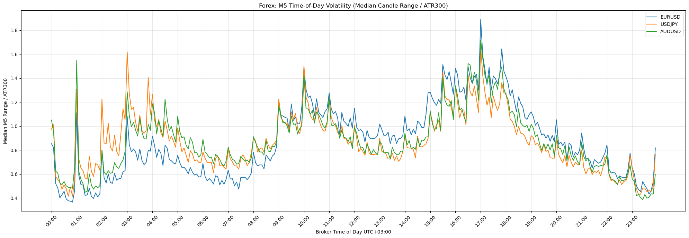
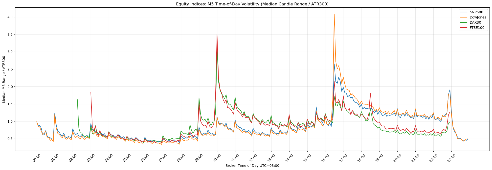
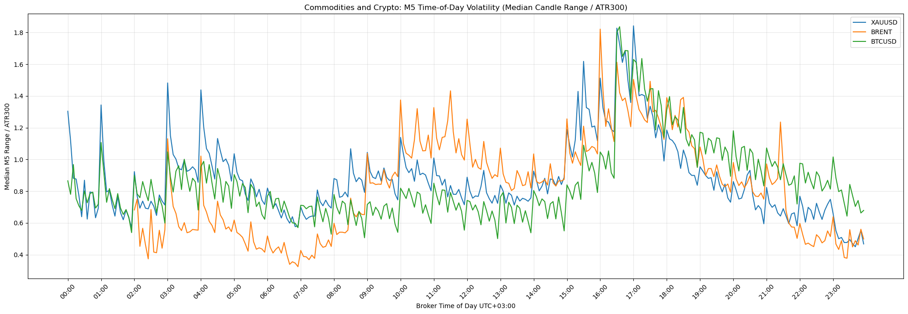
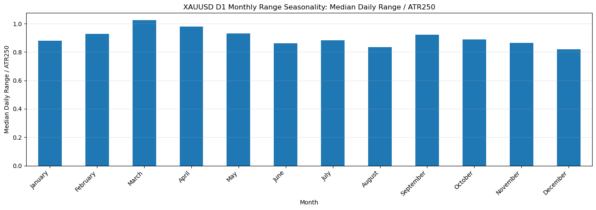

# Cross-Asset Range Seasonality

**Research question:** When does price range expand during the trading day and calendar year, and do the patterns recur across instruments and sampling frequencies?

This [MT5 research notebook](organized_mt5_volatility_analyzer.ipynb) studies a range-based volatility proxy for ten broker symbols: EURUSD, USDJPY, AUDUSD, S&P 500, Dow Jones, DAX, FTSE 100, gold, Brent, and Bitcoin. It analyzes one-minute (M1), five-minute (M5), and daily (D1) candles.

## Approach

The pipeline loads and sorts MT5 OHLC data, computes true range, and divides each candle's high–low range by a **simple rolling mean of true range** (called ATR in the notebook). The rolling mean includes the candle being measured; it is not Wilder's ATR. Medians summarize time of day, non-overlapping timestamp buckets, weekdays, months, and days of the month; session and daily tables also show upper quantiles. Candle directional efficiency is `|close − open| / (high − low)`.

The main normalization windows are **1,500 M1 bars**, **300 M5 bars**, and **250 D1 bars**. Ratios are dimensionless, allowing comparison of *relative* range patterns across price scales. The intraday plots label timestamps as UTC+03:00, an assumption that has not been verified against the source CSVs.

## What the saved results show

**The same broad intraday ranking appears at two frequencies.** In both M1 and M5 output tables, the fixed 16:30–19:00 timestamp bucket has the highest median normalized candle range for **8 of 10** symbols. For EURUSD M5, median(range/ATR300) is **1.34** in that bucket versus **0.71** at 03:00–10:00. Histories are broker-specific and not aligned, so this is agreement across saved samples, not a same-window replication or return forecast.

| Highest-median timestamp bucket in both M1 and M5 | Symbols |
| --- | --- |
| 16:30–19:00 | EURUSD, USDJPY, AUDUSD, S&P 500, Dow Jones, gold, Brent, Bitcoin |
| 10:00–12:00 | DAX, FTSE 100 |

*Each point is the median of individual M5 candle range/ATR300 ratios at that recorded time. The late-afternoon rise appears in all three FX profiles.*

**The timing is instrument-specific.** The equity-index profiles contain sharp peaks near 10:00 and 16:30 on the recorded clock, while the FX profiles show a broader rise. Three grouped charts show all ten symbols without stacking every line on one axis.

*Same M5 metric and recorded clock as the FX chart. Gaps reflect timestamps without bars for some broker symbols.*

*The third group completes the ten-symbol M5 comparison. Peaks are descriptive and require timezone verification before linking them to market events.*

**The D1 work tests a different scale of seasonality.** Gold's saved median daily range/ATR250 is approximately **1.02 in March** and **0.82 in December**. The notebook also compares months, weekdays, and days of the month across all ten symbols; these are exploratory differences rather than established calendar effects.

*Monthly medians are calculated from daily candles after the ATR250 warm-up period.*

## Run on your own MT5 data

1. Install notebook dependencies: `pip install pandas numpy matplotlib jupyter`.
2. To fetch data, install `MetaTrader5` on Windows with an open, logged-in MT5 terminal. In [mt5_data_fetcher.py](mt5_data_fetcher.py), set `TIMEFRAMES_TO_FETCH = ["M1", "M5", "D1"]`, then set `SYMBOL` and run once for each broker alias expected by the notebook. Adjust CSV paths if your broker uses different names.
3. Open `organized_mt5_volatility_analyzer.ipynb` in Jupyter and run the cells. This reproduces the *method on new data*, not the exact displayed results: the original CSVs and their date windows are not in this repository.

## Limits

- **Coverage:** Original CSVs and aligned date windows are unavailable, so differences across symbols may include different market regimes.
- **Inference:** No uncertainty estimates, multiple-comparison adjustment, or out-of-sample strategy test; calendar and intraday peaks are hypotheses.
- **Clock and sessions:** The fetcher saves timezone-naive timestamps; the notebook applies no shift in its example calls, assumes UTC+03:00, and does not adjust for daylight saving time. Its full New York session range also groups a midnight-crossing session by calendar date. The candle-level findings above do not use that full-session statistic.
